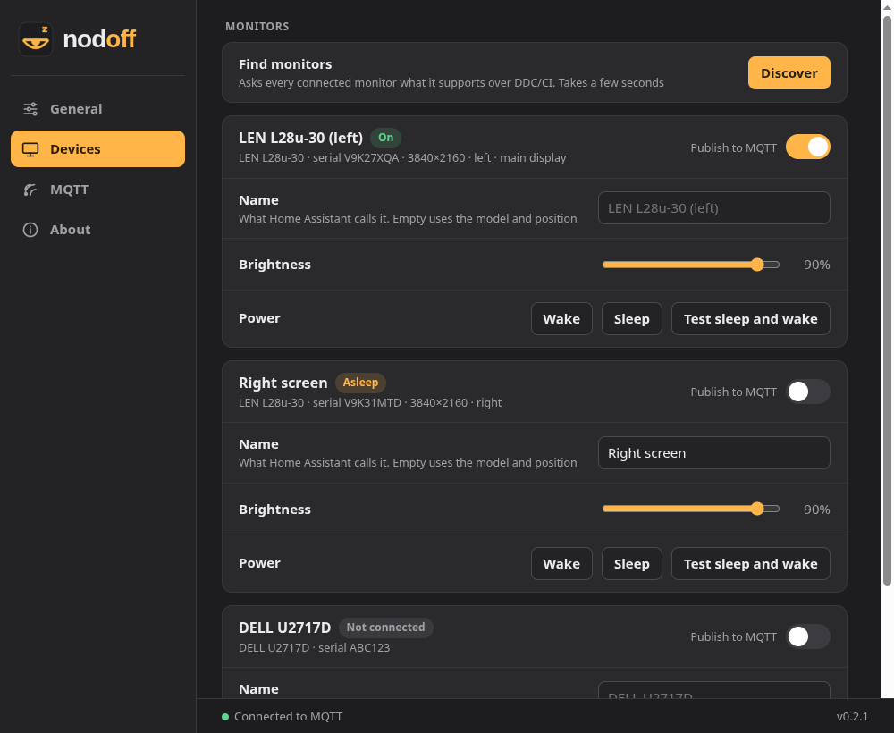
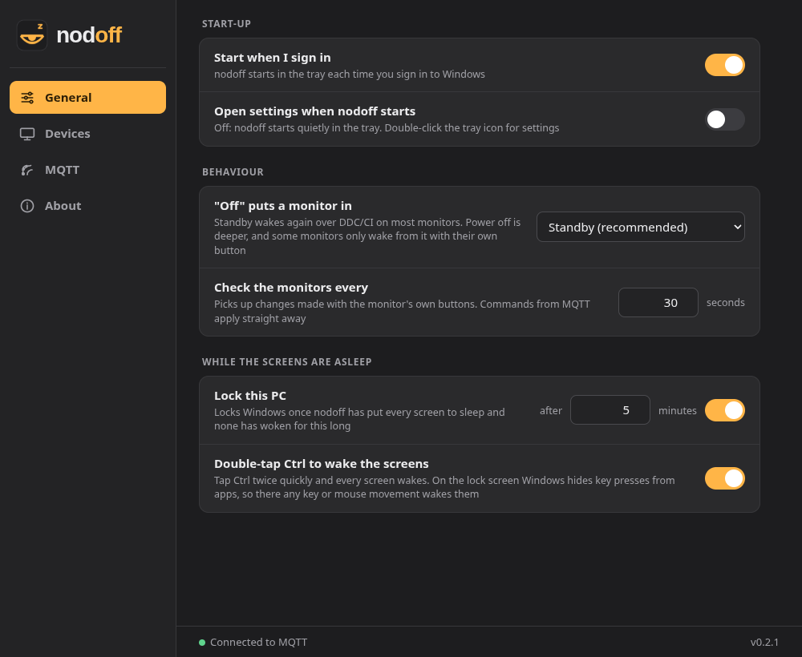

<p align="center"></p>

# nodoff

[](https://github.com/Tombo1001/nodoff/actions/workflows/ci.yml)
[](https://github.com/Tombo1001/nodoff/releases/latest)
[](LICENSE)

nodoff lets MQTT set your Windows PC's monitor brightness and put each monitor to sleep or wake it. Home Assistant is the main target: every monitor shows up there as a light with brightness. Point a presence sensor at your desk and the screens nod off when you walk away and wake when you sit down.

It talks to monitors over DDC/CI, the control channel inside HDMI, DisplayPort and DVI cables. That changes the real backlight and power state, the same as pressing the monitor's own buttons. Nothing is drawn over the screen and the GPU does no extra work.

It's a single exe with a tray icon and a settings panel. It runs as you, never as admin, and installs nothing system-wide.

> **Status:** early. Tested on one PC with two Lenovo L28u-30 monitors (one HDMI, one DisplayPort) and an Intel UHD 630. Other monitors and graphics cards are untested, and DDC/CI differs between them. Reports are welcome, see [CONTRIBUTING.md](CONTRIBUTING.md). Open items are in [TODO.md](TODO.md).



## Documentation

- [Home Assistant set-up](docs/home-assistant.md): broker, discovery, a presence automation and a dashboard card
- [Troubleshooting](docs/troubleshooting.md): monitors that don't answer or don't wake, MQTT errors, SmartScreen
- [How it works](docs/how-it-works.md): DDC/CI, the MQTT bridge, the settings panel
- [Security](SECURITY.md): how to report a problem, and what nodoff does and doesn't protect against
- [Changelog](CHANGELOG.md)

## What you get in Home Assistant

One device per PC, with one `light` entity per monitor you choose to publish:

- **On/off** wakes the monitor or sends it to standby (VCP code `D6`).
- **Brightness** 0 to 100 % sets the backlight (VCP code `10`).
- **Availability** greys the entity out when the PC is off, nodoff isn't running, or the monitor is unplugged.

A presence automation can then be as plain as:

```yaml
automation:
  - alias: Desk screens follow presence
    triggers:
      - trigger: state
        entity_id: binary_sensor.desk_presence
        to: ["on", "off"]
    actions:
      - action: "light.turn_{{ trigger.to_state.state }}"
        target:
          entity_id:
            - light.desk_pc_left_screen
            - light.desk_pc_right_screen
```

Entity IDs depend on the names you give the monitors. [docs/home-assistant.md](docs/home-assistant.md) has the full set-up.

## Install

Windows 10 or 11, 64-bit.

1. Download `nodoff-<version>-windows-amd64.zip` from the [latest release](https://github.com/Tombo1001/nodoff/releases/latest) and unzip it anywhere.
2. In that folder, run `powershell -ExecutionPolicy Bypass -File install.ps1` from a normal (not admin) PowerShell.
3. Settings opens. On **MQTT**, enter your broker and turn on **Connect to MQTT**. On **Devices**, press **Discover** and turn on **Publish to MQTT** for each monitor.
4. Press **Test sleep and wake** on each monitor before you automate it. Some monitors won't wake over DDC/CI from a deep sleep, and it's better to find out at the desk.

The installer copies `nodoff.exe` to `%LOCALAPPDATA%\Programs\nodoff`, adds a per-user start-at-sign-in entry and a Start menu shortcut. Settings live in `%LOCALAPPDATA%\nodoff`. Uninstall with `install.ps1 -Uninstall`; add `-RemoveSettings` to delete settings and the saved password too.

The exe isn't code-signed yet, so SmartScreen may warn the first time. Each release lists SHA-256 checksums.

## Settings

| Tab | What's there |
|---|---|
| General | Start when you sign in. Open the panel on start. What "off" means (standby or power off). How often to re-read the monitors. Lock the PC some minutes after the screens go to sleep. Double-tap Ctrl to wake the screens |
| Devices | Discover monitors. Per monitor: publish to MQTT, a name for Home Assistant, a live brightness slider, Wake, Sleep, and a sleep-and-wake test |
| MQTT | Broker, port, TLS, username, password. The PC's name in Home Assistant, the base topic, discovery on or off, the discovery prefix |
| About | Version, the settings folder and the log |



The tray icon is amber when MQTT is connected and grey when it isn't. Double-click it for settings. Right-click for Wake all, Sleep all and Quit.

## MQTT topics

You don't need Home Assistant. Everything is plain MQTT under the base topic (default `nodoff/<computer name>`). `<id>` is built from the monitor's EDID, for example `len65fa_v9k27xqa`, so it stays the same across reboots and cable swaps.

| Topic | Direction | Payload |
|---|---|---|
| `<base>/status` | nodoff publishes, retained | `online` / `offline` (also the last will) |
| `<base>/<id>/available` | nodoff publishes, retained | `online` / `offline` |
| `<base>/<id>/power` | nodoff publishes, retained | `ON` / `OFF` |
| `<base>/<id>/power/set` | you publish | `ON` / `OFF` |
| `<base>/<id>/brightness` | nodoff publishes, retained | `0` to `100` |
| `<base>/<id>/brightness/set` | you publish | `0` to `100` |

With discovery on, nodoff also publishes `homeassistant/light/<node>/<id>/config` (retained) and re-announces when Home Assistant sends `online` on `homeassistant/status`. Turning a monitor's publishing off, changing the base topic, or turning discovery off removes the old entries from Home Assistant.

## Security

- **No admin rights, ever.** The manifest asks for `asInvoker`, the installer is per-user, and start-up is a per-user `Run` registry entry. nodoff has no service and no elevated parts, so there's nothing to escalate through.
- **DLLs come from System32 only.** nodoff calls `SetDefaultDllDirectories(LOAD_LIBRARY_SEARCH_SYSTEM32)` at start and loads every Windows DLL by its System32 path, so a DLL dropped next to the exe isn't loaded. The few programs it starts (Edge for the panel, Explorer for "Open folder") are found through the Windows API, not through environment variables.
- **The MQTT password is in Windows Credential Manager** (generic credential `nodoff/mqtt`, this PC only). It's never written to `settings.json` or the log, and the settings panel can set or clear it but never read it back.
- **The settings panel is local and locked to its own window.** It listens on a random `127.0.0.1` port, checks the `Host` header (which stops DNS-rebinding attacks from web pages), rejects other origins, and needs a random key that changes each start. The page runs under a strict Content Security Policy with a per-load script nonce, and builds its DOM without `innerHTML`.
- **MQTT input is checked.** nodoff only acts on its own command topics, for monitors you published, with short payloads in range. Topic settings can't contain wildcards.
- **The keyboard hook is off unless you ask for it.** "Double-tap Ctrl to wake the screens" installs a low-level keyboard hook, which by its nature sees every key press. nodoff checks whether the key is Ctrl, keeps two timestamps and nothing else, and removes the hook when you turn the setting off. The lock screen hides key presses from all apps, so there nodoff only learns that some input happened.
- **TLS** to the broker uses TLS 1.2 or later and checks the certificate against the ones Windows trusts. Without TLS the MQTT password crosses your network in the clear, as with any MQTT client.
- CI runs `govulncheck` against the Windows build, and the release workflow refuses to build if it finds anything. The workflows pin their actions to commit hashes.

nodoff's settings and exe sit in your own profile, so other programs running as you can change them. That's the same trust level as any per-user app, and gives no route to admin. [SECURITY.md](SECURITY.md) covers the limits and how to report a problem.

## Build

Any OS with Go 1.26.11 or later. No cgo and no C compiler.

```bash
./scripts/build.sh            # vet, test, then dist/nodoff.exe
./scripts/deploy-ssh.sh HOST  # build, install on a Windows PC over OpenSSH, start it in the desktop session
go run ./tools/logopreview docs   # redraw the logo PNGs in docs/
python3 tools/ui-mock/mock.py 8791  # the settings panel with a fake API, at http://127.0.0.1:8791/?k=x
```

The logo is drawn in code (`internal/logo`) so the tray, exe icon and panel always match. `tools/mkrsrc` bakes the icon, version and manifest into the exe.

## How it finds monitors

Windows gives each display a handle for DDC/CI (`dxva2.dll`), but no stable name. nodoff matches each handle to its device through `EnumDisplayDevices`, reads the EDID from the registry, and builds the ID from the maker, product code and serial. Two identical monitors still get different IDs. Position (left, right) comes from the desktop layout and only feeds the default name.

More detail is in [docs/how-it-works.md](docs/how-it-works.md).

## Licence

MIT, see [LICENSE](LICENSE). The libraries built into the exe keep their own licences, listed in [THIRD-PARTY-NOTICES.md](THIRD-PARTY-NOTICES.md).
