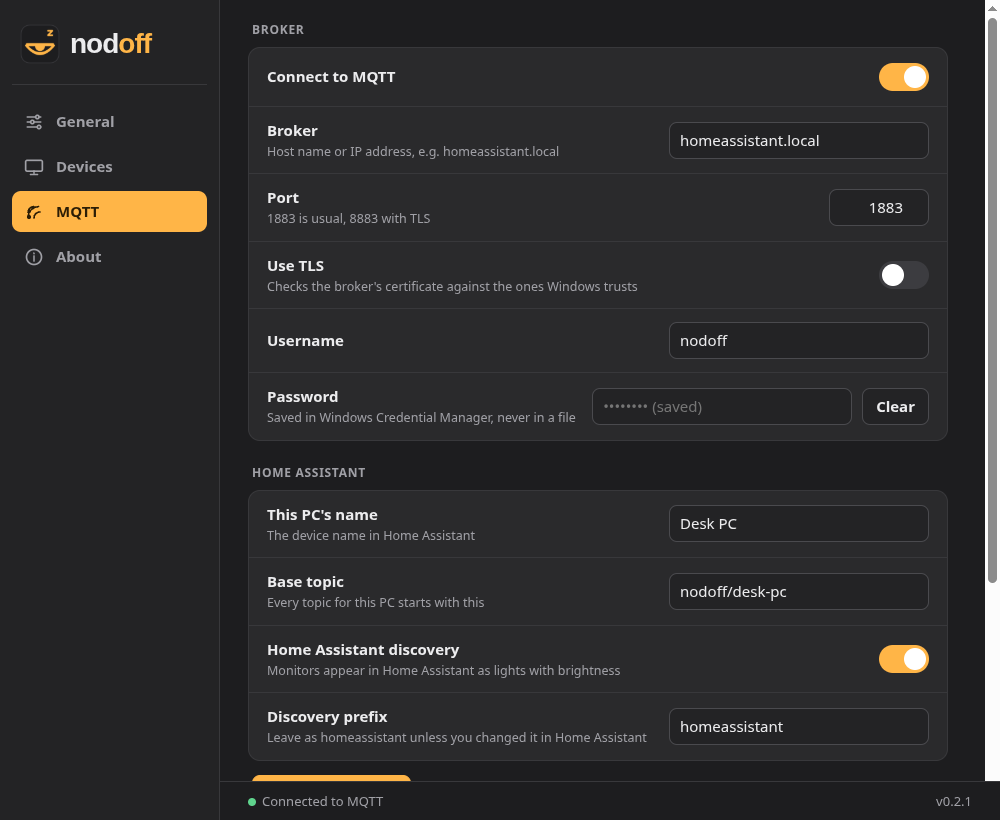
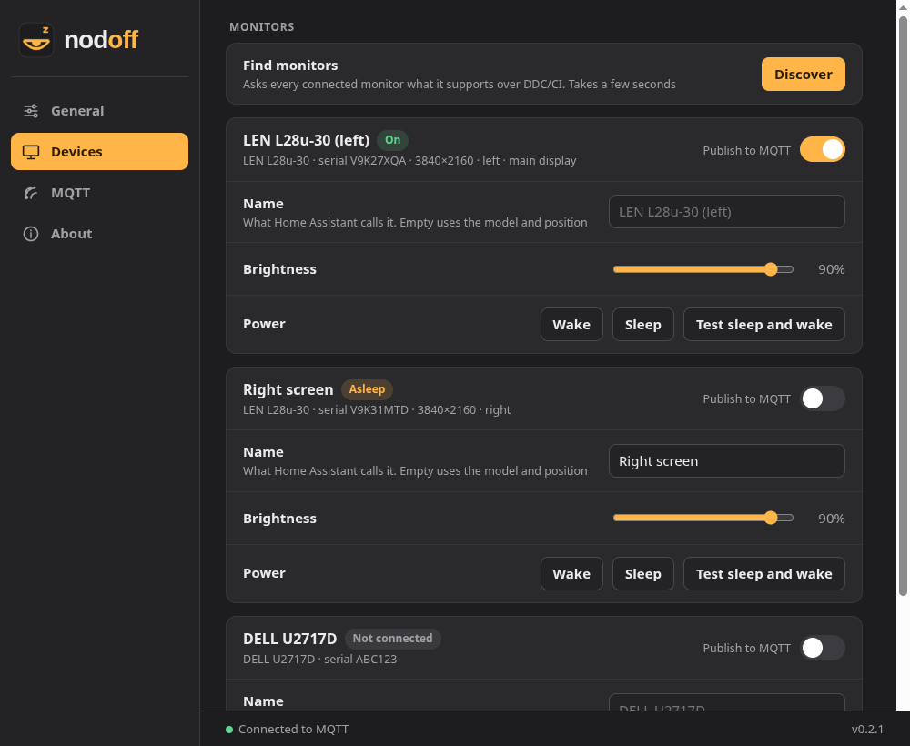

# Home Assistant

This page takes you from a fresh install to screens that follow a presence sensor.

## What you need

- Home Assistant with the MQTT integration set up and a broker it talks to. The Mosquitto add-on is the usual one.
- A broker user for nodoff. In the Mosquitto add-on, any Home Assistant user works. A dedicated one is better, so you can remove it later without touching anything else.
- nodoff installed on the PC. See the [README](../README.md#install).

## Connect nodoff to the broker

1. Open nodoff's settings (double-click the tray icon) and go to **MQTT**.
2. Enter the broker's host name or IP address, the port, the username and the password. Turn on **Use TLS** if your broker has it.
3. Set **This PC's name**. Home Assistant uses it as the device name.
4. Leave **Home Assistant discovery** on and the prefix as `homeassistant`, unless you changed the prefix in Home Assistant.
5. Turn on **Connect to MQTT** and press **Save and connect**. The footer and the tray icon show when it's connected.



## Publish your monitors

On **Devices**, press **Discover**. For each monitor you want in Home Assistant, turn on **Publish to MQTT** and give it a name such as "Left screen".



Press **Test sleep and wake** on each one before you automate anything. It sends the monitor to sleep, waits five seconds and wakes it. If the monitor stays dark, wake it with its own power button and read [Troubleshooting](troubleshooting.md#a-monitor-sleeps-but-doesnt-wake).

## What appears in Home Assistant

One device named after the PC, under **Settings > Devices & services > MQTT**. It has one light per published monitor:

- on and off wake the monitor or send it to standby;
- brightness is the monitor's own backlight, 0 to 100 %;
- the light shows as unavailable when the PC is off, nodoff isn't running or the monitor is unplugged.

Entity IDs come from the PC's name and the monitor's name, for example `light.desk_pc_left_screen`.

## Follow a presence sensor

```yaml
automation:
  - alias: Desk screens follow presence
    triggers:
      - trigger: state
        entity_id: binary_sensor.desk_presence
        to: "on"
      - trigger: state
        entity_id: binary_sensor.desk_presence
        to: "off"
        for: "00:02:00"
    actions:
      - action: "light.turn_{{ trigger.to_state.state }}"
        target:
          entity_id:
            - light.desk_pc_left_screen
            - light.desk_pc_right_screen
```

The two-minute wait on "off" stops the screens going dark when the sensor loses you for a moment. Waking has no wait.

Add nodoff's **Lock this PC** setting (General tab) and the PC locks a few minutes after the automation has put every screen to sleep.

## Dim in the evening

```yaml
automation:
  - alias: Dim the desk screens after sunset
    triggers:
      - trigger: sun
        event: sunset
    actions:
      - action: light.turn_on
        target:
          entity_id:
            - light.desk_pc_left_screen
            - light.desk_pc_right_screen
        data:
          brightness_pct: 35
```

`light.turn_on` with a brightness also wakes a sleeping monitor. If you want to dim only when the screens are already on, add a condition on the light's state.

## A dashboard card

The built-in tile card gives each screen a toggle and a brightness slider:

```yaml
type: tile
entity: light.desk_pc_left_screen
name: Left screen
icon: mdi:monitor
features:
  - type: light-brightness
```

## Removing things

Turning off **Publish to MQTT** for a monitor removes its light from Home Assistant. Turning off discovery, or changing the base topic or the prefix, removes all of this PC's lights under the old names first. If you uninstall nodoff without doing either, delete the device in Home Assistant by hand.

## Without Home Assistant

Everything works over plain MQTT. The topics are in the [README](../README.md#mqtt-topics), and the MQTT tab lists them for your own base topic.
